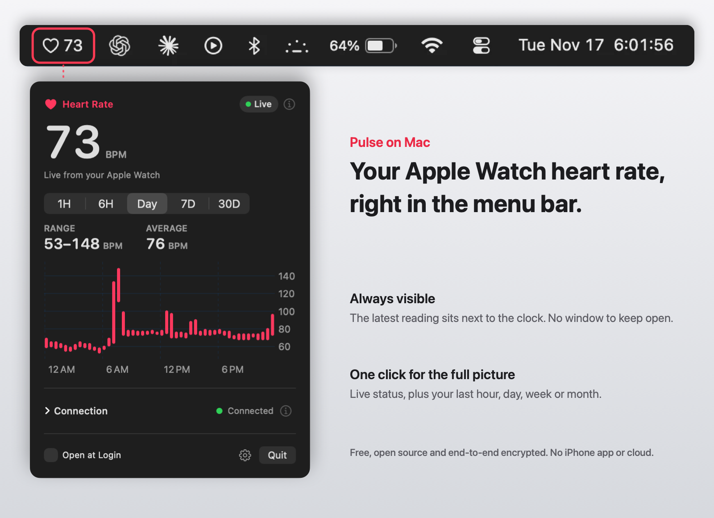

# Pulse on Mac


Your Apple Watch heart rate in the Mac menu bar, with a trend chart. Readings
go straight from the Watch to the Mac over your own Wi-Fi: no iPhone app, no
account, no cloud.

<p align="center">
  
</p>


- **Live** — tap Go Live on the Watch for a new reading every few seconds.
- **Periodic** — with the Watch app closed, the Mac still gets your readings
  about every 15 minutes, a few minutes old, and fills in the chart between.
- **Trend** — the last hour, 6 hours, day, 7 days or 30 days, kept on your Mac
  for 30 days. Week and month views show each day's low and high.
- **Alerts** — optional notifications when your heart rate stays above or
  below limits you set. The menu bar number changes color past them.
- **Your menu bar, your way** — heart and number, number only, or heart only.
  Alerts and menu bar options are under the gear button in the popover.
- **Encrypted** — every reading is end-to-end encrypted between your Watch
  and Mac. Works with VoiceOver.

> This is not an App Store app. You build and install it yourself with Xcode
> and a free Apple ID. See "Limits" before you start.

## What you need

- A Mac with macOS 15 or later and Xcode 16 or later
- An Apple Watch with watchOS 11 or later, with Developer Mode on
  (Watch: Settings > Privacy & Security > Developer Mode)
- A free Apple ID added in Xcode > Settings > Accounts
- [XcodeGen](https://github.com/yonaskolb/XcodeGen): `brew install xcodegen`
- Mac and Watch on the same Wi-Fi network

## Install

1. Get the code:

   ```bash
   git clone https://github.com/aaryanvani-PM/pulse-on-mac.git
   cd pulse-on-mac
   ```

2. Create `local.env` in the project folder with your own values:

   ```
   HR_TEAM_ID=ABCDE12345
   HR_BUNDLE_PREFIX=com.yourname
   ```

   The Team ID is under Xcode > Settings > Accounts > your team. The prefix
   can be anything unique to you.

3. Build and start the Mac app:

   ```bash
   Scripts/install-mac.sh
   ```

   A heart appears in the menu bar. The app is called **Pulse on Mac**. Allow Local Network access if macOS asks.

4. Build and install the Watch app (Watch unlocked and near the Mac):

   ```bash
   Scripts/install-watch.sh
   ```

   The first time, the Watch asks you to trust your developer certificate:
   Settings > General > VPN & Device Management.

   If either script reports a signing error, open
   `HeartRateMenuBar.xcodeproj` in Xcode once, choose your team under
   Signing & Capabilities for each target, build to your Watch from Xcode,
   and then use the scripts from then on.

5. Pair. On the Mac, click the menu-bar heart and open **Connection** to see
   the pairing number. On the Watch, open **Pulse**, type that number
   on the keypad and tap Pair. Allow Health access when asked. You do this
   once.

6. For periodic updates, add the **Pulse** complication to the watch
   face you actually use. watchOS only wakes the app in the background while
   its complication is on the active face.

## Limits

- **Seven-day renewal.** Apps installed with a free Apple ID stop launching
  after seven days. Run `Scripts/install-watch.sh` again to renew; pairing and
  settings are kept. A paid Apple Developer membership removes this.
- **Periodic is not live.** watchOS allows about four background wakes an
  hour, so closed-app readings arrive roughly every 15 minutes and are a few
  minutes old on arrival. The menu bar always shows when a reading was
  measured. Only Go Live gives live values.
- **Live uses a workout session.** That is the only way watchOS provides
  second-by-second heart rate. The session is discarded: nothing is saved to
  Health and your Activity rings are not affected. It uses more battery.
- **If the Mac's address changes,** open the Watch app and keep it on screen.
  After a failed send (up to a minute) it looks for your Mac on the same
  network and reconnects by itself; this can take from a second to a few
  minutes. If the Mac moved to a different network, or the search finds
  nothing, tap Unpair Mac and enter the new pairing number.
- **Encryption covers readings, not pairing tricks.** Readings are
  encrypted end to end, and the pairing key never crosses the network. Pair
  on a network you trust: someone actively intercepting the few seconds of
  pairing could in theory guess the 4-digit code.
- **Alerts aren't medical.** They need two readings in a row past your
  limit, so with the Watch app closed one can take up to about 30 minutes.
  Your Apple Watch has its own heart notifications in Settings > Heart.

## Privacy

Readings stay on your devices. The Mac keeps 30 days of history in
`~/Library/Application Support/HRMenuBar/history.json`. Nothing is sent to
any server. Diagnostic logs record times and delivery steps, never heart-rate
values.

## Troubleshooting

- **Menu bar shows "No recent reading":** check the Watch is on your wrist,
  on the same Wi-Fi, and the complication is on the current face. Then open
  the Watch app once; it syncs immediately.
- **Watch says "Mac unreachable" or "Looking for your Mac…":** the Mac's
  address has probably changed. Keep the Watch app open for a few minutes; if
  it does not reconnect, unpair and enter the pairing number again.
- **Watch app will not open:** the seven days are up; reinstall it.
- **Still stuck:** the Mac log is at `~/Library/Logs/HRMenuBar/ingest.jsonl`.

## For developers

`project.yml` is the source of truth; `Scripts/generate.sh` creates the Xcode
project from it. `bash Tests/run-background-checks.sh` runs the logic checks.
How the pieces fit, what was measured on a real Watch, and the platform
limits are in [Docs/HOW-IT-WORKS.md](Docs/HOW-IT-WORKS.md). Automatic iCloud
pairing is written but switched off, because it needs a paid developer team.

Screenshots use made-up data. Launch the Mac app with `-HRDemo` to show a
day of sample readings and a ticking live value (no receiver runs, nothing
is saved). Add `-HRDemoExport <folder>` to save popover screenshots and a
short video there. The Watch app accepts `-HRDemo` in the simulator.

## Licence

MIT. See [LICENSE](LICENSE).
